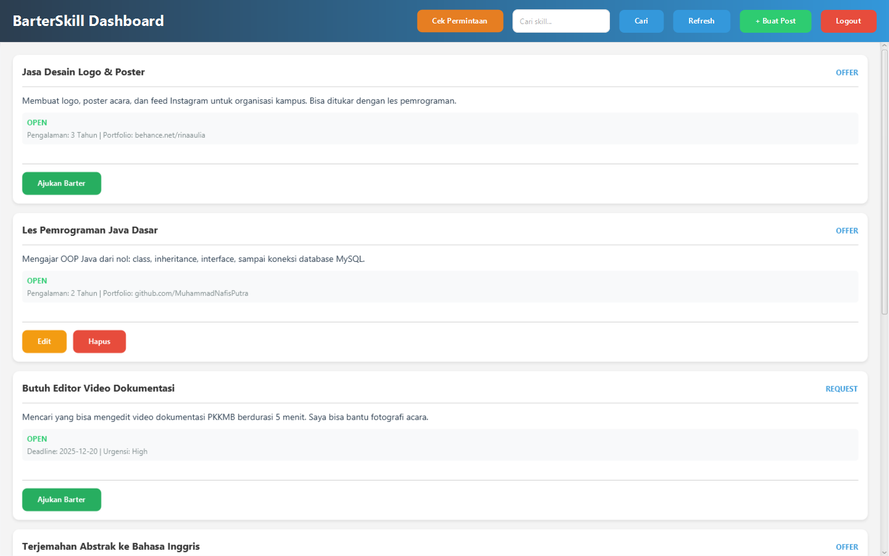
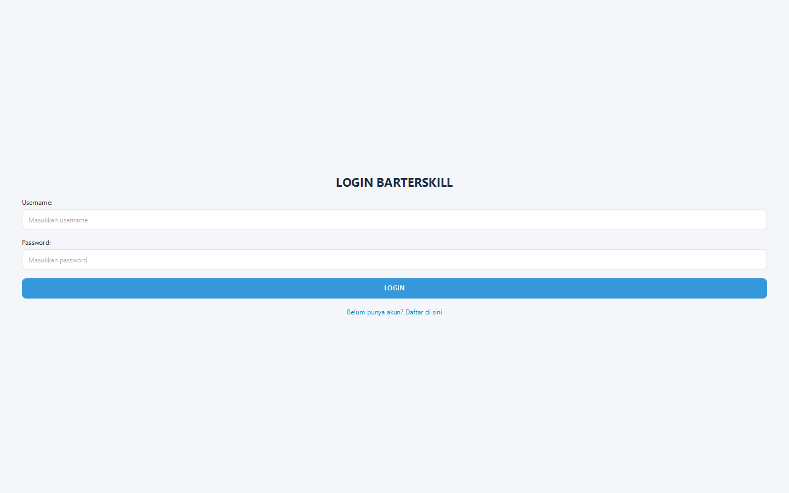
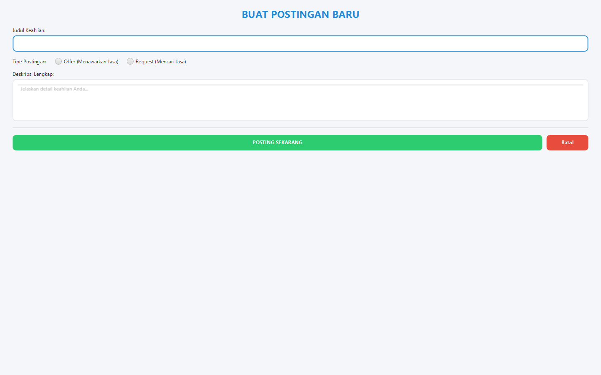
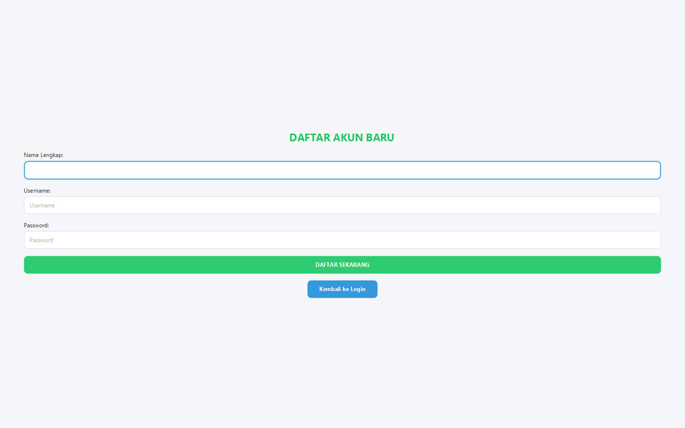

# BarterSkill

Aplikasi desktop tempat mahasiswa bertukar keahlian tanpa uang. Setiap postingan berupa
**Offer** (keahlian yang ditawarkan) atau **Request** (keahlian yang dicari). Pengguna lain
mengajukan barter, lalu pemilik postingan menerima atau menolaknya.

Proyek UAS Pemrograman 2, Teknologi Informasi Universitas Lambung Mangkurat (2025).

## Fitur
- Registrasi dan login
- Dashboard daftar postingan dengan pencarian
- Buat, lihat, edit, dan hapus postingan Offer / Request
- Pengajuan barter dengan status Pending → Accepted / Rejected

## Teknologi
Java 21 · JavaFX 21 (FXML + CSS) · MySQL lewat JDBC · Maven

## Struktur & konsep OOP
- `model/`: kelas abstrak `Postingan` diturunkan menjadi `Offer` dan `Request`
- `Repository/`: akses database lewat `PostRepositoryInterface` dan PreparedStatement
- `Controller/` + `resources/.../view/*.fxml`: pola MVC

## Menjalankan
1. Jalankan MySQL (mis. XAMPP), lalu impor `database/barterskill.sql`.
   Isinya data demo; akun demo: `nafis` / `demo123`.
2. Sesuaikan koneksi di `src/main/java/com/example/pemro/Repository/DataBase.java` bila perlu.
3. `./mvnw javafx:run`

## Tampilan
| Login | Buat postingan | Registrasi |
|---|---|---|
|  |  |  |

Dibuat oleh Muhammad Nafis Putra.
